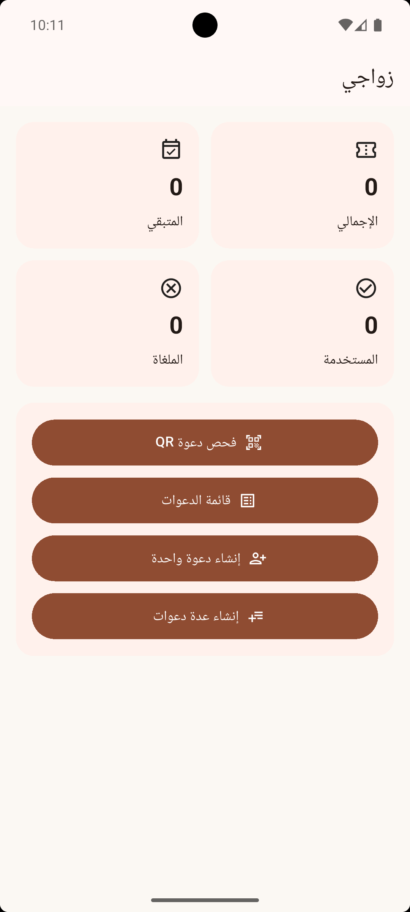

# Wedding QR Local App

A Flutter-based offline wedding invitation management application designed to create, manage, generate, and validate one-time QR invitations.

The application works locally on the device using SQLite, making it suitable for event entry management without requiring an internet connection or a remote backend.

## Features

- Create individual wedding invitations
- Create multiple invitations in bulk
- Generate a unique QR code for each invitation
- Scan and validate QR invitations using the device camera
- One-time invitation validation
- Prevent reuse of already-used invitations
- Cancel invitations
- Reset invitations to unused status
- Edit invitation details
- Delete invitations
- Search invitations by guest name
- Dashboard with invitation statistics
- Local SQLite database
- Scan activity logging
- Arabic RTL user interface
- Material 3 based UI
- Compact QR payload format for lower QR density
- Backward compatibility with legacy JSON QR payloads

## Screenshots

### Dashboard



### QR Scanner


### Create Invitation


### Invitations List


### Generated Invitation QR


## Architecture

The project follows a feature-oriented structure with separated data, core, shared, and feature layers.

```text
lib/
├── core/
│   ├── constants/
│   └── utils/
│
├── data/
│   ├── local/
│   ├── models/
│   └── repositories/
│
├── features/
│   ├── dashboard/
│   ├── invitations/
│   └── scanner/
│
├── shared/
│   └── widgets/
│
├── app.dart
└── main.dart
```

## Technology Stack

- Flutter
- Dart
- SQLite
- Sqflite
- QR Flutter
- Mobile Scanner
- UUID
- Material 3

## How It Works

Each invitation is stored locally with a unique identifier and token.

A QR code is generated for the invitation and can then be scanned at the event entrance.

When a QR code is scanned, the application:

1. Decodes the QR payload.
2. Verifies that the code belongs to the application.
3. Verifies the event identifier and QR format version.
4. Searches the local SQLite database.
5. Checks the invitation status.
6. Accepts a valid unused invitation.
7. Marks the invitation as used.
8. Records the scan result in the local scan log.

## Offline Operation

The application is designed to operate locally.

Invitation data is stored in an SQLite database on the device, so the main invitation management and validation workflow does not require a remote backend.

## QR Code Design

The application uses a compact QR payload format:

```text
W1.<compact-token>
```

The compact format reduces the amount of data encoded in the QR code compared with the legacy JSON representation.

Legacy JSON QR codes are also supported for compatibility.

## Configuration

The event identifier is defined in:

```text
lib/core/constants/app_constants.dart
```

Example:

```dart
static const String eventId = 'wedding_default_2026';
```

This value should remain unchanged after invitations have been generated and distributed for the event.

## Installation

Make sure Flutter is installed and configured correctly.

Clone the repository:

```bash
git clone https://github.com/yazannasr288/wedding-qr-local-app.git
```

Enter the project directory:

```bash
cd wedding-qr-local-app
```

Install dependencies:

```bash
flutter pub get
```

Run the application:

```bash
flutter run
```

## Building APK

To generate a release APK:

```bash
flutter build apk --release
```

The generated APK can be found under:

```text
build/app/outputs/flutter-apk/
```

## Project Status

This project is a standalone offline Flutter application created for wedding invitation management and QR-based entrance validation.

## License

This project is licensed under the MIT License.
See the [LICENSE](LICENSE) file for details.